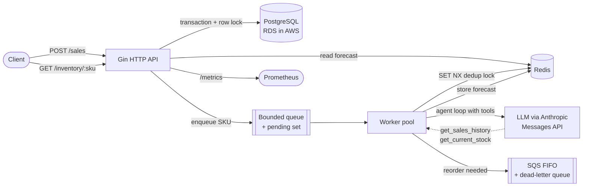

# Predictive Inventory System

[](https://github.com/xtylo/predictive-inventory/actions/workflows/ci.yml)

A Go service that records sales, forecasts demand per product with an LLM agent, and publishes reorder requests when stock falls short of the forecast.

Built as a portfolio project to learn Go, concurrency, AWS and LLM tool use, in eight one-hour sessions. Every number in this README was measured; how is documented next to it.

## What it does

1. `POST /sales` records a sale and decrements stock in one transaction, safely under concurrency and idempotent on retries.
2. Each new sale schedules a demand forecast for its SKU on a background worker pool.
3. The forecast comes from an agent loop: the model calls tools to read the SKU's sales history and stock, then submits a structured 30-day forecast with a short rationale.
4. `GET /inventory/:sku` compares the cached forecast with current stock and returns how many units to reorder.
5. When a reorder is needed, a message goes to an SQS FIFO queue for the fulfillment system.

## Architecture



## Engineering highlights

| Problem | Solution | Proven by |
| --- | --- | --- |
| Two concurrent sales oversell the last unit | `SELECT ... FOR UPDATE` row lock inside a transaction, plus a `CHECK (stock >= 0)` constraint as the last line of defense | Test: 50 buyers race for 30 units; exactly 30 succeed, stock ends at 0 |
| A client retries a sale and stock drops twice | Required `Idempotency-Key` header, enforced by a `UNIQUE` column and `ON CONFLICT DO NOTHING`; a retry returns the original sale with `200` | Test: 10 concurrent retries of one key decrement stock once |
| A burst of sales triggers one expensive model call per sale | Per-SKU distributed lock in Redis (`SET NX` with a 5-minute TTL), kept for the whole window and released on failure | Test: 20 triggers on 4 workers reach the model once |
| Model latency (seconds) backs up the API (milliseconds) | Bounded channel queue with non-blocking enqueue; SKUs already waiting are not queued twice; `429` with `Retry-After` on the refresh endpoint | Load test: queue-full rejections went from 1,525 to 0 |
| The LLM returns malformed or invalid answers | `tool_choice: any` forces a structured `submit_forecast` call; its input is validated as untrusted, and errors go back as `is_error` tool results so the model corrects itself; at most 6 turns | Tests against an `httptest` fake of the Messages API |
| Shutdown loses in-flight work | `signal.NotifyContext`, then `http.Server.Shutdown`, then a worker drain, under one 15-second deadline | Test: a 1-hour prediction does not hold shutdown past its deadline |
| Local and cloud infrastructure drift apart | One Terraform module for the queue, applied to LocalStack and to AWS; only the provider configuration differs | The same binary passed the end-to-end flow on both |

## Results

Load test with k6 (open model, 80% reads / 20% sales over 100 SKUs) on a 6-vCPU laptop shared by k6, the API, PostgreSQL and Redis. Targets: 2,500 req/s with p99 under 200 ms.

| Offered load | p99 reads | p99 writes | Errors | Thresholds |
| --- | --- | --- | --- | --- |
| 2,500 req/s | 2.0 ms | 6.2 ms | 0% | ✓ |
| 5,000 req/s | 75 ms | 81 ms | 0% | ✓ |
| 10,000 req/s | 3.95 s | 3.95 s | 0% | ✗ saturated at ~4,630 req/s |

The target is met with a wide margin, and capacity on this machine is about 4,600–5,000 req/s. Past it, latency is pure queueing: the measured 625 ms p50 at saturation matches Little's law (3,000 requests in flight / ~4,630 completions per second ≈ 0.65 s). Full methodology, environment artifacts and worker efficiency: [`loadtest/RESULTS.md`](loadtest/RESULTS.md).

**Forecast quality, first real run:** for SKU-3 the model forecast 585 units for the next 30 days against 544 sold in the previous 30, consistent with the upward trend in the data, and it correctly treated today's zero sales as a partial day rather than a stockout. This is one sample on synthetic data, not an accuracy benchmark.

**On AWS:** the same binary ran against RDS PostgreSQL and a real SQS FIFO queue, with the schema created by its embedded migrations. The infrastructure was created and destroyed with Terraform in the same session.

## API

| Method and path | Responses |
| --- | --- |
| `POST /sales` (header `Idempotency-Key`) | `201` new sale, `200` retry of a known key, `400` invalid, `404` unknown SKU, `409` not enough stock |
| `GET /inventory/:sku` | `200` with `reorder_quantity` and the forecast's `rationale`, `200` with `forecast_pending` when none is cached yet, `404` unknown SKU |
| `POST /forecasts/:sku/refresh` | `202` queued, `404` unknown SKU, `429` queue full (with `Retry-After`), `503` shutting down |
| `GET /health` | `200` |
| `GET /metrics` | Prometheus metrics: HTTP latency by route, queue depth, job outcomes, model tokens, reorders |

```bash
curl -X POST localhost:8080/sales -H 'Content-Type: application/json' \
  -H 'Idempotency-Key: order-1001' -d '{"sku":"SKU-3","quantity":2}'

curl localhost:8080/inventory/SKU-3
```

## Running it

Everything runs in a VS Code dev container: the only requirements on the host are Docker and VS Code with the Dev Containers extension.

1. Open the repository in VS Code and choose **Reopen in Container**. It starts Go, PostgreSQL, Redis and LocalStack, and installs Terraform and the AWS CLI.
2. Create the local queue and load sample data:

   ```bash
   terraform -chdir=infra/envs/local init && terraform -chdir=infra/envs/local apply
   docker exec -i predictive-inventory_devcontainer-postgres-1 psql -U inventory < scripts/seed.sql
   docker exec -i predictive-inventory_devcontainer-postgres-1 psql -U inventory < scripts/seed_sales.sql
   ```

3. Start the API (migrations run on startup):

   ```bash
   export SQS_REORDER_QUEUE_URL=$(terraform -chdir=infra/envs/local output -raw reorder_queue_url)
   go build -o bin/api ./cmd/api && ./bin/api
   ```

Without an API key the service uses a fake predictor, free and deterministic. To use a model, set the variables below; any endpoint compatible with the Anthropic Messages API works.

| Variable | Purpose | Default |
| --- | --- | --- |
| `POSTGRES_DSN` | PostgreSQL connection string | required |
| `REDIS_ENDPOINT` | Redis address | required |
| `PORT` | HTTP port | `8080` |
| `ANTHROPIC_API_KEY` | Model API key; empty selects the fake predictor | empty |
| `ANTHROPIC_BASE_URL` | Gateway compatible with the Messages API | Anthropic API |
| `ANTHROPIC_MODEL` | Model ID | `claude-haiku-5-5` |
| `SQS_REORDER_QUEUE_URL` | Reorder queue; empty disables publishing | empty |

## Testing

```bash
go test -race ./...                 # unit and integration tests (needs Docker)
bash scripts/integration_test.sh    # end to end: sale -> forecast -> SQS message
RATE=2500 DURATION=60s bash scripts/loadtest.sh   # load test with k6
```

Integration tests start throwaway PostgreSQL containers with `testcontainers-go`; Redis tests use `miniredis` in memory; LLM tests use an `httptest` fake of the Messages API, so they never call a real model. CI runs formatting, `go vet`, the full test suite with the race detector, the image build, and `terraform fmt` and `validate` on every push.

## Project layout

```text
cmd/api/              entry point: wiring, worker start, graceful shutdown
internal/
  config/             environment variables
  httpapi/            Gin handlers, routing, metrics middleware
  store/              PostgreSQL: sales, stock, daily history
  cache/              Redis: forecasts and distributed locks
  planning/           reorder rule (pure function)
  predictor/          Predictor interface, LLM agent loop, fake
  worker/             bounded queue and worker pool
  reorder/            reorder decision and SQS publisher
migrations/           SQL migrations embedded in the binary
infra/                Terraform: shared module, local and AWS environments
loadtest/             k6 script and results
scripts/              seed data, end-to-end test, load test runner
```

## Design decisions

- **Hand-written agent loop instead of an agent framework.** The official Claude Agent SDK targets TypeScript and Python. With the official Go SDK, the loop is about a hundred lines, fully visible and testable, and works with any model behind a compatible endpoint.
- **Sales never fail because of the forecast queue.** The original requirement returned `429` from `POST /sales` when the queue was full, but by then the sale is committed. Queueing after a sale is best effort; back-pressure is exposed on the refresh endpoint, where rejecting is honest.
- **A missing forecast is a state, not an error.** `GET /inventory` answers `forecast_pending` instead of a `500`.
- **The consumer declares the interface.** Handlers and workers depend on small interfaces they define (`StockReader`, `ForecastWriter`...), so tests use plain struct fakes instead of a mocking library.
- **No load test against the cloud database.** With the API on a laptop and RDS in another region, each sale's five database round trips would measure the network, not the system. Capacity was measured locally; the AWS run proves the system works there unchanged.

## Backlog

- **Transactional Outbox** for reorder messages: today the forecast and the SQS message are written separately, so a failure between them loses that reorder until the next forecast.
- **Local L1 cache in front of the Redis lock:** 86% of enqueued jobs still reach Redis only to be skipped.
- **Deterministic baseline forecast** (moving average) next to the LLM's, to measure accuracy and as a fallback.
- **Deploy the API next to RDS** (ECS or EC2) to load test in the cloud, and find whether the API, PostgreSQL or the load generator saturates first.
- **OpenTelemetry tracing** with a trace backend.
- Out of scope from the start: ECS/EKS, API Gateway, ElastiCache, CDK, CSV ingestion from S3.

## About the business numbers

The original project brief described business impact (tons of waste avoided, monthly savings). This system has not run against real sales, so those figures are a simulated scenario, not results. The measured results are the ones above.

The session-by-session plan and progress log are in [`docs/PLAN.md`](docs/PLAN.md).
